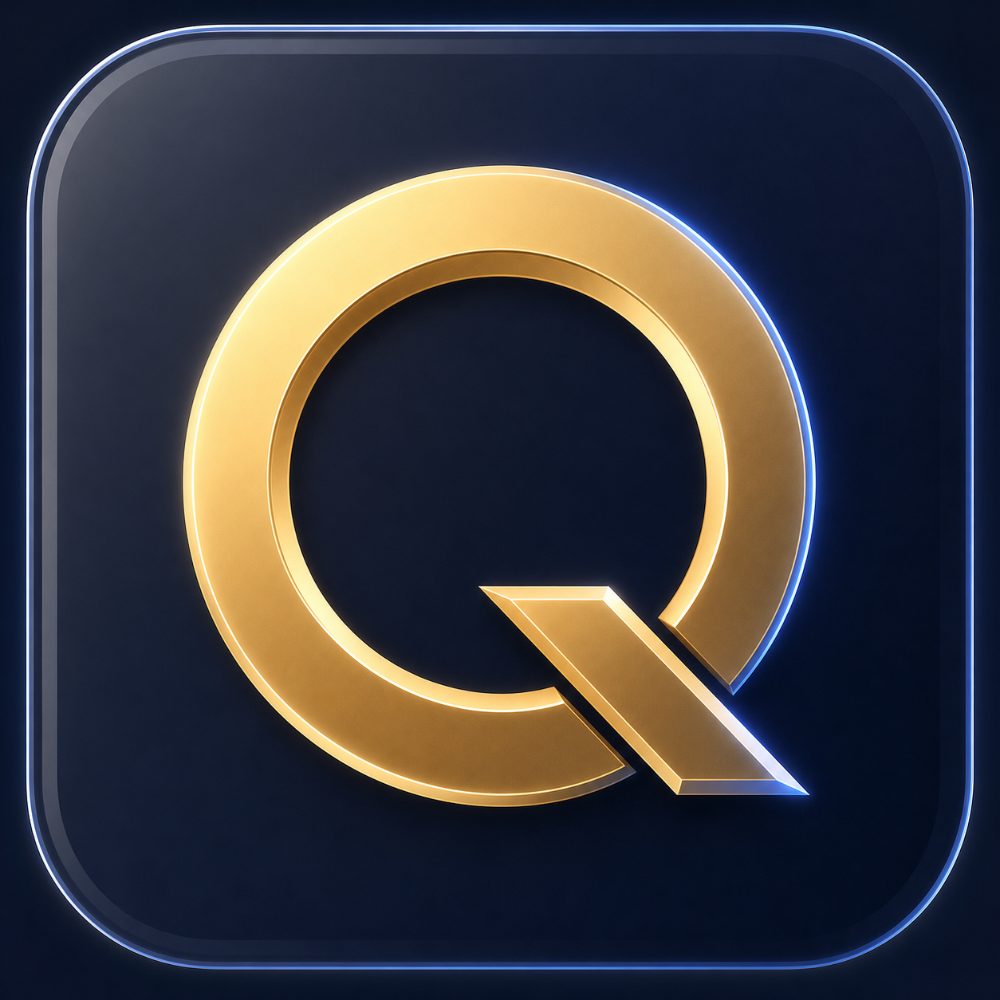

<p align="center">
  
</p>

<h1 align="center">onQ</h1>

<p align="center">
  <b>A fast, local-first prompt vault for desktop.</b>
  <br />
  Portable Markdown · encrypted local index · optional semantic search · system tray · global shortcut
</p>

<p align="center">
  <a href="https://github.com/visorcraft/onQ/releases/latest"></a>
  <a href="https://visorcraft.github.io/onQ/"></a>
  
  
  
</p>

## What onQ does

onQ keeps prompts under your control. Each prompt is a Markdown file with
YAML frontmatter. A disposable local index makes the vault fast to search.
No hosted account, cloud prompt service, subscription, or telemetry is
required.

Press **Win+Q** on Windows, **Meta+Q** on Linux, or **⌘+Q** on macOS to open
the Palette from anywhere. The shortcut can be recorded again in Settings.

## Features

| Area | Shipped behavior |
|---|---|
| Fast retrieval | Keyword search works immediately; optional local MiniLM embeddings add semantic search and hybrid RRF ranking |
| Portable storage | Prompts remain readable `prompts/*.md` files with stable YAML frontmatter |
| Vault access | Create or open multiple vault folders; recent vaults are remembered outside the vault |
| Key protection | Use a master password, or an app-generated key stored by the OS keychain with a 24-word recovery phrase |
| Selective secrecy | Lock individual prompt bodies with AES-256-GCM and separate per-prompt keychain keys |
| Organization | Projects, tags, favorites, recent prompts, unfiled prompts, smart folders, and saved searches |
| Prompt tools | Draft editing, Markdown body copy, templates, history restore, MinHash similarity, and local tag suggestions |
| Portability | Markdown directory import, Markdown export, and full `.onqbak` backup and restore |
| Desktop integration | System tray, single-instance behavior, auto-lock, custom global shortcut, and six UI languages |
| Transparency | Local audit log, bundled dependency credits, and public feature-status limits |

The [feature-status page](https://visorcraft.github.io/onQ/feature-status)
separates finished user paths from partial plugin, live-sync, and updater
work.

## Security boundary

The search index is encrypted. Unlocked prompt source files are plaintext
Markdown by design. Session lock closes access to the index, but it does not
encrypt every source file. Use prompt locks for selected bodies and normal
disk encryption for whole-device protection.

Read the [security model](https://visorcraft.github.io/onQ/security) before
choosing an authentication mode or relying on prompt locks. In particular:

- a forgotten master password cannot be recovered;
- the vault recovery phrase restores the generated vault key, not
  per-prompt lock keys;
- old history snapshots may retain body text created before a prompt was
  locked;
- an unsealed backup is compressed, not encrypted.

## Install

Download the latest package from
[GitHub Releases](https://github.com/visorcraft/onQ/releases/latest).

Current release automation targets:

| Platform | Architecture |
|---|---|
| macOS | Apple silicon (`aarch64`) |
| Linux | x86-64 |
| Windows | x86-64 |

See the [installation guide](https://visorcraft.github.io/onQ/installation)
for platform prerequisites, first-launch notes, and Linux global-shortcut
permissions.

## Quick start

1. Launch onQ and choose an empty or existing directory.
2. Select master-password or system-keychain protection.
3. Save the recovery phrase if keychain mode creates one.
4. Create a prompt, then press the global shortcut and search for it.
5. Optionally download the local semantic model in **Settings > Search**.

The semantic model is not downloaded automatically. Keyword search remains
available without it.

## Documentation

The complete user and contributor guide is published at
[visorcraft.github.io/onQ](https://visorcraft.github.io/onQ/).

- [Quick start](https://visorcraft.github.io/onQ/quick-start)
- [Search and ranking](https://visorcraft.github.io/onQ/search)
- [Library and organization](https://visorcraft.github.io/onQ/library)
- [Editing, templates, locks, and history](https://visorcraft.github.io/onQ/editing)
- [Settings reference](https://visorcraft.github.io/onQ/settings)
- [Backups and recovery](https://visorcraft.github.io/onQ/backups)
- [Privacy and network behavior](https://visorcraft.github.io/onQ/privacy)
- [Prompt file format](https://visorcraft.github.io/onQ/file-format)
- [Vault layout and local state](https://visorcraft.github.io/onQ/vault-layout)
- [Troubleshooting](https://visorcraft.github.io/onQ/troubleshooting)
- [Architecture](https://visorcraft.github.io/onQ/architecture)
- [Plugin authoring](https://visorcraft.github.io/onQ/plugins)
- [Development](https://visorcraft.github.io/onQ/development)

Repository references:

- [Contributing](CONTRIBUTING.md)
- [Plugin authoring source](docs/plugins/README.md)
- [Architecture decisions](docs/adr/)
- [Security reporting](.github/SECURITY.md)

## Develop

Prerequisites:

- Node.js 24+
- Rust stable
- [Tauri platform dependencies](https://v2.tauri.app/start/prerequisites/)

```bash
git clone https://github.com/visorcraft/onQ
cd onQ
npm install
npm run dev:app
```

`mongreldb-core` resolves from crates.io. No sibling checkout is needed.

Useful checks:

```bash
npm run check
npm run lint
npm test
cargo fmt --all -- --check
cargo clippy --workspace --all-targets -- -D warnings
cargo test --workspace
```

Build packages with:

```bash
npm run build:app
```

Bundles are written under `target/release/bundle/`. See
[CONTRIBUTING.md](CONTRIBUTING.md) for the full workflow.

## Architecture

```text
src/                         Svelte 5 + TypeScript UI
  lib/api/                   Tauri invoke wrappers
  lib/components/            Screens and reusable UI
  lib/stores/                Client state
crates/
  onq-app/                   Tauri shell and IPC commands
  onq-core/                  Vault, crypto, search, backup, and domain logic
  onq-plugin-sdk/            Versioned native plugin ABI
  onq-test-utils/            Shared Rust test helpers
docs-site/                   VitePress public documentation
tests/                       Playwright and plugin fixtures
```

The main stack is Tauri 2, Svelte 5, TypeScript, Rust, Tokio, MongrelDB, and
an optional 384-dimensional MiniLM model.

## Project status

onQ is on the 1.x line. Vault and index formats may evolve. Create a backup
before a major upgrade.

Live filesystem reconciliation, complete plugin command execution, alternate
plugin embedders, update installation, and beta-feed routing are not complete
end-to-end product paths. See
[Feature status](https://visorcraft.github.io/onQ/feature-status) for the
current boundary.

## License

onQ is licensed under
[GPL-3.0-only](LICENSE). In-app **Credits** and **Licenses** list bundled
Rust crates, npm packages, and runtime components.
